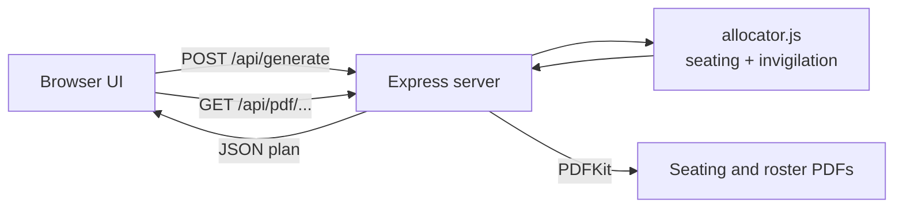

# Exam Seat & Invigilation Allocator

A full-stack web app that automatically generates **exam seating plans** and **invigilator duty rosters** from room, student, teacher and exam-schedule data, and exports both as **PDFs**.

Planning an exam by hand means juggling room capacities, subject clashes and teacher workloads. This app does it in one click using a constraint-based allocation algorithm.

**Live demo:** [https://exam-seat-allocator.onrender.com](https://exam-seat-allocator.onrender.com)
*(Hosted on Render's free tier. The first load can take 30-60 seconds while the server wakes up.)*

---

## Features

- **Automatic seating plans**: students are placed room by room, seat by seat, with no same-subject students next to each other (left or front).
- **Fair invigilation roster**: teachers are assigned to rooms with balanced workload, no double-booking within a time slot, and a per-teacher duty cap.
- **Multiple exam slots**: exams on different dates or times are planned separately, with a slot switcher in the UI.
- **PDF export**: download the seating plan (one page per room) and the duty roster (with a per-teacher load summary).
- **Colour-coded seating grid**: each subject has its own colour, so clashes are visible at a glance. Hover a seat to see the student's name and branch.
- **CSV upload**: load rooms, students, teachers and exams from CSV files, or paste them in.
- **Clear error messages**: if capacity is too low or there are not enough teachers, the app tells you exactly what to fix.
- **Light and dark mode**: follows the browser setting.

## Tech Stack

| Layer | Technology |
|---|---|
| Backend | Node.js, Express.js |
| PDF generation | PDFKit |
| Frontend | HTML, CSS, vanilla JavaScript |
| Testing | Node.js script that checks the allocation constraints |
| Hosting | Render (free tier) |

## How It Works



### Seating algorithm

The goal is to fill every room while keeping students who write the same subject apart.

1. Group the students of a time slot by subject.
2. Pick the smallest set of rooms that covers all students (largest rooms first). If total capacity is too small, stop with a clear error.
3. Fill seats one by one. For each seat, look at the student on the **left** and the one in **front**, then choose the subject with the **most students remaining** that does not clash with those two. Picking the biggest remaining group first prevents a single large subject from being stranded at the end.
4. If a placement gets stuck, the plan is rebuilt with small random changes to the ordering (**randomized restarts**, up to 300 attempts) and the best result is kept. The search stops as soon as a clash-free plan is found.

The number of remaining clashes is reported in the summary so the result can be trusted rather than assumed.

### Invigilation algorithm

Each room needs N invigilators (configurable). For every room in every slot, the allocator:

- skips teachers already assigned in the same slot (**no double-booking**),
- skips teachers who reached the **maximum duty limit**,
- prefers teachers who do **not teach a subject being examined in that room** (a soft constraint, counted and reported),
- among the remaining candidates, picks the one with the **lowest current load**, which keeps the workload balanced.

If no teacher qualifies, the app returns an error asking you to add teachers or raise the duty limit.

## Getting Started

**Requirements:** Node.js 18 or newer.

```bash
git clone https://github.com/Pooja970-web/-Exam-seat-invigilation-allocator-.git
cd -Exam-seat-invigilation-allocator-
npm install
npm start
```

Open `http://localhost:3000`, click **Load sample data**, then **Generate plan**.

Run the test:

```bash
npm test
```

## Input Format

Enter one record per line, with no header row. You can paste the data or upload CSV files.

| Tab | Format | Example |
|---|---|---|
| Rooms | `name, rows, columns` | `R101,5,6` |
| Students | `id, name, branch, subjects` (separate several subjects with `;`) | `S1,Asha Rao,CS,MATH` |
| Teachers | `name, subject` | `Prof. Mehta,MATH` |
| Exams | `subject, date, time` | `MATH,2026-12-01,10:00` |

Exams with the same date and time form one slot and are seated together.

## API

| Method | Endpoint | Description |
|---|---|---|
| `POST` | `/api/generate` | Takes `rooms`, `students`, `teachers`, `exams`, `perRoom`, `maxDuties`. Returns the plan, summary statistics and an `id`. |
| `GET` | `/api/pdf/seating/:id` | Seating plan PDF for a generated plan |
| `GET` | `/api/pdf/roster/:id` | Duty roster PDF for a generated plan |

Example request body:

```json
{
  "rooms": [{ "name": "R101", "rows": 5, "cols": 6 }],
  "students": [{ "id": "S1", "name": "Asha Rao", "branch": "CS", "subjects": ["MATH"] }],
  "teachers": [{ "name": "Prof. Mehta", "subject": "PHY" }],
  "exams": [{ "subject": "MATH", "date": "2026-12-01", "time": "10:00" }],
  "perRoom": 2,
  "maxDuties": 5
}
```

## Project Structure

```
.
├── allocator.js        # Seating and invigilation algorithms
├── server.js           # Express server, REST API and PDF generation
├── test.js             # Constraint test for the allocator
├── package.json
└── public/
    └── index.html      # Frontend (UI, CSV upload, seating grids)
```

## Known Limitations

- Plans are kept in server memory, so they are lost when the server restarts. Generate and download the PDFs in the same session.
- Each student takes one subject per time slot.
- There is no login or database yet.

## Future Improvements

- [ ] Database (MongoDB or PostgreSQL) to save rooms, students and generated plans
- [ ] Admin login and per-institution data
- [ ] React frontend
- [ ] Teacher availability and leave constraints
- [ ] Branch-mixing constraint for seating
- [ ] Backtracking or constraint-solver based optimisation (for example OR-Tools)
- [ ] Docker setup and GitHub Actions CI

## Author

**Pooja Kushwaha**
GitHub: [@Pooja970-web](https://github.com/Pooja970-web)
